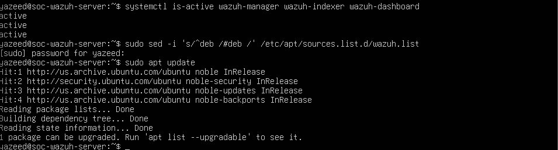
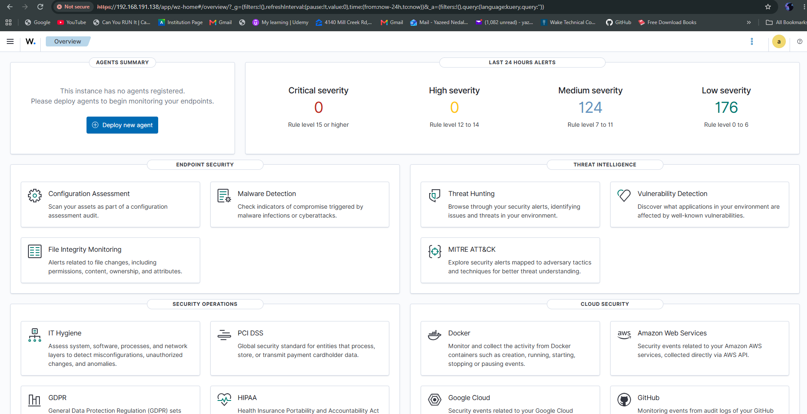

# SOC & Incident Response Lab

## Project status

**In progress — Windows endpoint connected and first file integrity monitoring test verified.**

Installed the Wazuh server, indexer, and dashboard on Ubuntu Server.
Connected Windows11-Endpoint and verified Windows event collection.

Completed a controlled file modification test. Wazuh detected the
change and recorded the added text, before-and-after hashes,
and file size change.

Next: finish organizing the FIM screenshots and write the first
investigation report.

## Overview

This project documents my progress building a security operations
lab to collect security logs, investigate suspicious activity,
and practice incident response.

The monitoring platform is Wazuh. Investigation scenarios include
file changes, failed logins, and service discovery.

Testing and documentation are being completed step by step.
Completed work and planned activities are identified separately.

## Learning goals

- Understand how security logs are collected and analyzed.
- Set up Wazuh and connect a monitored endpoint.
- Generate controlled test events inside my own lab.
- Investigate alerts and distinguish test activity from normal behavior.
- Use Nmap to identify exposed services in the lab.
- Document evidence, findings, limitations, and response recommendations.

## Lab environment

| Component | Configuration |
| --- | --- |
| Host operating system | Windows 11 |
| Virtualization platform | VMware Workstation 17 Pro |
| Server operating system | Ubuntu Server 24.04.5 LTS |
| Virtual machine | SOC-Wazuh-Server |
| Allocated VM resources | 4 vCPUs, 8 GB RAM, 50 GB virtual disk |
| Network mode | NAT |
| Remote administration | SSH from Windows Terminal |
| Monitored endpoint | Windows 11 host laptop |
| Wazuh agent name | Windows11-Endpoint |
| Windows agent version | 4.14.8 |
| FIM test directory | `C:\SOC-Lab\FIM-Test` |

Before installing Wazuh, verified CPU allocation, available memory,
disk space, and clock synchronization. Ubuntu reported approximately
40 GB of available disk space, and Windows reported 64.4 GB free
on C:. These measurements were taken before the Wazuh installation.

The server uses UTC, with network time synchronization verified
during setup. The Windows test timestamp recorded a UTC offset
of -04:00.

## Tools and their purpose

| Tool | Purpose | Status |
| --- | --- | --- |
| VMware Workstation | Run the lab virtual machine | Configured |
| Ubuntu Server | Host Wazuh's central components | Installed |
| OpenSSH | Administer Ubuntu from Windows Terminal | Connection verified |
| Wazuh | Collect and analyze security events | Installed; dashboard access verified |
| Windows Wazuh agent | Send endpoint events and monitor designated files | Event collection and file-change detection verified |
| PowerShell | Administer the Windows agent and generate controlled test activity | Used |
| Nmap | Discover ports and services within the lab | Planned |
| GitHub | Maintain documentation and version history | In use |

## Work completed

- Created the project repository and initial documentation.
- Created an Ubuntu Server virtual machine in VMware.
- Installed Ubuntu and configured a user account.
- Enabled SSH access.
- Compared the server's SSH host fingerprint before accepting
  the first connection.
- Successfully connected from Windows Terminal.
- Checked Ubuntu package updates and applied available upgrades.
- Restarted Ubuntu when a reboot was required.
- Verified resources, available storage, and time synchronization.
- Installed the Wazuh server, indexer, and dashboard using the
  official installation assistant.
- Verified that all three Wazuh services reported `active`.
- Successfully logged in to the Wazuh dashboard.
- Disabled the Wazuh package repository to prevent accidental
  upgrades. Ubuntu's update sources remain enabled.
- Installed the Wazuh agent on Windows11-Endpoint.
- Confirmed the endpoint's Active status.
- Inspected a Windows Error Reporting event to verify Windows
  event collection.
- Created a designated FIM test folder containing a harmless text file.
- Added real-time file integrity monitoring configuration with
  text-change reporting enabled.
- Verified that the initial scan completed and real-time monitoring started.
- Checked connectivity and confirmed the agent reconnected after
  a temporary interruption.
- Performed a controlled file modification and inspected the resulting alert.
- Confirmed the added text, changed hashes, and file size increase
  from 30 to 74 bytes.

## Setup evidence

### Wazuh services running

Verified that the Wazuh manager, indexer, and dashboard services
all reported `active`.



### Initial dashboard access

Successfully accessed the Wazuh dashboard from Windows.
This screenshot records the initial installation stage, before
the Windows endpoint was registered.

The displayed alert counts were not investigated at that stage.



### File integrity monitoring evidence

Captured and reviewed screenshots showing:

- The file modification alert.
- The endpoint identity and alert rule.
- The exact added text, changed hashes, and before-and-after file sizes.

Evidence filenames for the `screenshots` folder:

- `fim-file-modified-alert.png`
- `fim-alert-details.png`
- `fim-change-details.png`

Uploading and linking the complete FIM evidence set remains
a documentation task until verified in the repository.

## Investigation scenarios

| Scenario | Objective | Status |
| --- | --- | --- |
| File modification | Detect a controlled change and inspect the supporting evidence | Detection verified; detailed report pending |
| Failed logins | Generate controlled authentication failures and investigate the resulting logs and alerts | Planned |
| Service discovery | Scan a designated lab system with Nmap and document exposed services | Planned |

Each investigation will document the objective, procedure,
observed evidence, analysis, limitations, and response recommendations.

## Investigation findings

### Controlled file modification — October 15, 2026

**Objective:** Verify that Wazuh detects a change to a designated
test file and records evidence of the changed contents.

**Endpoint:** `Windows11-Endpoint`

**Test file:** `C:\SOC-Lab\FIM-Test\example.txt`

The initial file contained:

```text
SOC lab baseline - version 1
